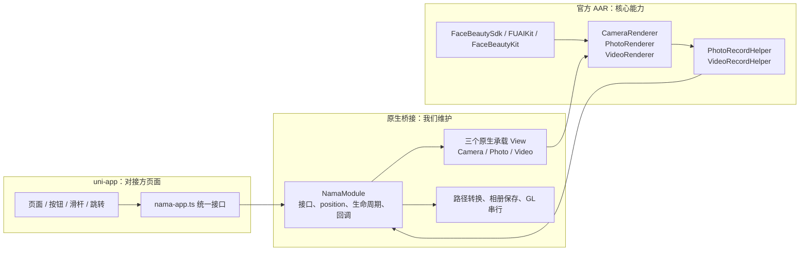
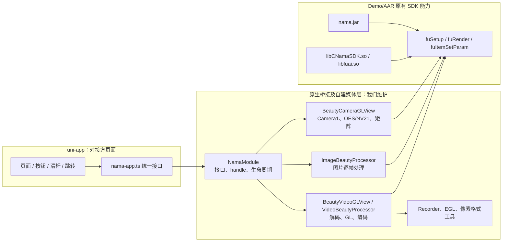

# Android 两套实现对比与对外方案建议

## 1. 背景与目标

本次对比两套已经实现的 Android 方案：

- **方案 A：当前分支** `feat/android-face-beauty-aar-kit`，官方 Kit AAR 实现。
- **方案 B：`ios` 分支中的 Android 实现**，基于 Demo/AAR 原有实现的自有 GL/媒体封装。

目标是确定后续对外默认提供哪套方案。本文只保留架构、实际使用、变更影响和事实结论；没有实测依据的内容标为“未验证”。

**结论：对外默认提供方案 A；方案 B 仅作为现有项目兼容和回退基线。**

## 2. 方案架构

### 2.1 方案 A：官方 Kit AAR



边界：

- uni-app 负责业务页面和普通 UI。
- 原生桥接只负责 Android 适配，不重新实现渲染和编码。
- 官方 AAR 负责相机、图片、视频、美颜、拍照读回和视频编码。
- `SurfaceView` 上方可能被遮挡的对焦框、美颜面板等保留原生 UI，其余页面可由客户自定义。

复用与重新实现范围：

| 复用官方能力 | 我们实现的适配 |
| --- | --- |
| `CameraRenderer`、`PhotoRenderer`、`VideoRenderer` | Renderer 的原生 View 承载和生命周期 |
| `FaceBeautyKit`、`FUAIKit` | JS 参数到 Kit 参数的映射 |
| `PhotoRecordHelper`、`VideoRecordHelper` | 回调转换、文件路径和系统相册落盘 |
| 官方相机对焦、曝光、分辨率 | position、坐标转换和 Surface 层级 |

### 2.2 方案 B：Demo/AAR 原有实现 + 自有封装



边界：

- uni-app 页面职责与方案 A 基本相同。
- Demo/AAR 原有 SDK 提供底层接口，但相机输入、GL、图片/视频逐帧处理和编码适配主要由项目代码承担。
- SDK 升级或设备差异更容易影响相机、图片、视频和资源释放多个位置。

### 2.3 架构差异总结

| 对比项 | 方案 A | 方案 B |
| --- | --- | --- |
| 核心依赖 | 官方 Kit AAR | Demo/AAR 原有 SDK 接口 + 各 ABI Native so |
| 相机 | 官方 `CameraRenderer/FUCamera` | 自建 `BeautyCameraGLView` |
| 图片 | 官方 `PhotoRenderer` | `ImageBeautyProcessor` 自有封装 |
| 视频 | 官方 `VideoRenderer` | `BeautyVideoGLView/VideoBeautyProcessor` 自有封装 |
| 拍照/导出 | 官方 RecordHelper | 自有像素和编码适配 |
| 自定义代码重点 | 桥接和生命周期 | 桥接 + 完整媒体处理链路 |

## 3. 实际使用对比

### 3.1 功能、接入和页面

| 项目 | 方案 A | 方案 B | 判断 |
| --- | --- | --- | --- |
| 相机、美颜、切摄 | 官方 Renderer/Kit | Demo/AAR 原有接口 + 自建 GL | 业务入口对等 |
| 对焦、曝光、分辨率 | 官方 `FUCamera` | 自建相机适配 | 业务入口对等 |
| 拍照、相机录像 | 官方 RecordHelper + 相册适配 | 自定义读回/录像 | 结果形式对等，内部不同 |
| 图片预览和导出 | 官方 `PhotoRenderer/PhotoRecordHelper` | Demo/AAR 原有图片处理封装 | 方案 A 更接近官方能力层 |
| 视频预览和导出 | 官方 `VideoRenderer/VideoRecordHelper` | Demo/AAR 原有视频处理封装 | 编码和音频结果需专项实测 |
| 选择图片/视频 | Vue 选择页 + 原生系统选择器 | 同类业务流程 | 可保持一致 |
| 自定义页面 | Vue 页面 + position；原生 View 主要承载官方 Renderer | Vue 页面 + position；原生 View 同时包含采集、GL 和媒体处理 | position 接入方式一致，维护边界不同 |
| Android/iOS | 业务接口一致，底层不同 | 底层模型更接近 iOS 现有实现 | 两者都不是同一底层实现 |

接入步骤：

- 方案 A：引入桥接 AAR、三个官方 AAR 和匹配的 `authpack`，重新制作离线包或自定义基座。
- 方案 B：引入桥接 AAR、`nama.jar`、各 ABI Native so 和匹配的 `authpack`。

页面统一通过业务接口调用，不直接接触 Renderer、纹理或底层 item：

```ts
await initNamaForBeauty()
await setBeautyParam('blur_level', 3.3)
await setBeautyStringParam('filter_name', 'origin')
await setBeautyEnabled(true)
```

方案 A 仍保留 `loadBundle → handle → setParam` 这一现有 JS 形式，但 Android 实际由 `FuKitBridge` 设置官方 Kit，不再创建自有 media item。

### 3.2 三方接入成本

这里的“成本”指接入方需要准备的依赖、原生配置、页面工作和后续维护工作；当前没有按人日实测，以下是代码范围判断。

| 接入项 | 方案 A | 方案 B |
| --- | --- | --- |
| 依赖准备 | 桥接 AAR + 三个官方 AAR + 视频播放依赖 | 桥接 AAR + `nama.jar` + 各 ABI Native so |
| 初始化配置 | `FaceBeautySdk`、AI、`FaceBeautyKit` 按官方顺序初始化 | 按 Demo/AAR 原有顺序初始化 SDK、AI、item 和 GL |
| 页面接入 | 页面调用统一 JS 接口；预览区域通过 position 挂载 | 页面调用统一 JS 接口；预览区域同样通过 position 挂载 |
| 自定义 UI | 普通 UI 可全部由 Vue 编写；遮挡 GL 的控件使用原生层 | 普通 UI 可用 Vue，但需要关注自有 GL 层、触摸和生命周期 |
| 原生改动 | 通常集中在桥接适配和 SDK 版本适配 | 可能需要修改相机、图片、视频、编码和资源释放代码 |
| 对接风险 | 主要是 AAR 版本、资源、签名和自定义基座 | 除上述内容外，还要处理 ABI、GL 上下文、矩阵和像素格式 |
| 维护成本 | 预计较低，实际人日未验证 | 预计较高，实际人日未验证 |

两套方案的预览区域都通过 position 挂载原生 View，首次页面接入方式接近；差异主要出现在 position 内部原生 View 的复杂度、依赖配置和后续 SDK 升级维护。

### 3.3 Android/iOS 一致性边界

- 两端共用页面、参数配置和主要业务方法。
- Android 方案 A 使用官方 Kit AAR；iOS 继续使用现有 `FaceUnityNama.framework`。
- Android 使用 `ACTION_OPEN_DOCUMENT`，iOS 使用系统图片选择器，最终都向页面返回本地路径。
- 一致性应定义为“用户功能和业务接口一致”，不能定义为“底层调用链或像素结果完全一致”。

## 4. 变更影响对比

### 4.1 模拟新增滤镜或美颜效果

以新增一个 `new_filter_level` 参数为例：

| 修改位置 | 方案 A | 方案 B |
| --- | --- | --- |
| 页面配置 | `src/config/beauty-effects.ts` 增加名称、范围、默认值和图标 | 相同 |
| Vue 页面 | 复用现有滑杆，通过 `setBeautyParam` 调用 | 相同 |
| JS 桥接 | 通常无需新增公共接口，只增加参数配置 | 通常无需新增公共接口 |
| Android 适配 | `FuKitBridge` 增加官方参数映射或调用；按需要在 Renderer GL 线程执行 | `NamaModule`、参数应用类和对应处理器增加 item 参数或渲染逻辑 |
| 未被 SDK 直接支持时 | 需要在官方 AAR 或 `FuKitBridge` 增加算法调用，并在 Renderer 回调中接入 | 需要在自有相机/图片/视频链路分别接入 |
| 影响范围 | 参数映射、能力判断和三类 Renderer 验证 | 相机、图片、视频三套处理链路都可能修改 |
| 测试范围 | 参数默认值、滑杆范围、相机/图片/视频效果、关闭和恢复 | 上述项目加逐帧、矩阵、编码和资源释放 |

如果官方 Kit 已提供该滤镜参数，方案 A 通常只需在 `FuKitBridge` 增加映射；如果只是 Demo 页面有该效果但 AAR 没有公开接口，则不能直接复制页面代码，需要先确认 AAR 能力或申请 SDK 接口。

### 4.2 模拟底层 AI 算法新增接口

例如 AI 新增“人体关键点检测”或“遮挡检测”接口：

| 步骤 | 方案 A | 方案 B |
| --- | --- | --- |
| SDK 接入 | 升级官方 AAR，确认 `FUAIKit`/`FURenderKit` 新接口 | 更新 Demo/AAR 原有 SDK 文件和 Native so |
| 原生封装 | 在 `FuKitBridge` 增加统一方法，负责初始化、调用和释放 | 在 `NamaModule` 或自有处理类中直接封装接口 |
| 渲染关联 | 若算法只返回结果，页面通过回调使用；若参与画面，需要接入三个官方 Renderer 的对应生命周期 | 需要分别接入相机、图片、视频的自有逐帧链路 |
| JS 接口 | 只有业务要读取结果时才新增，如 `getBodyLandmarks` | 相同，但底层回调和线程适配更多 |
| 页面修改 | 只增加展示或业务处理 | 相同 |
| 影响范围 | 主要集中在官方 SDK 适配层和回调 | SDK、多个处理器、GL/线程和资源释放 |
| 测试范围 | 初始化、检测结果、无目标、切换页面、释放、三类 Renderer | 上述项目加多链路逐帧一致性和 EGL 资源竞争 |

结论：新增 AI 接口时，方案 A 先把能力收口到 `FuKitBridge`；方案 B 更容易把算法调用散落到多个处理类。

### 4.3 模拟 SDK 升级后的改动成本

| 成本项 | 方案 A | 方案 B |
| --- | --- | --- |
| 依赖替换 | 更新三个官方 AAR 和构建依赖 | 更新 SDK 文件、Native so 和 ABI 配置 |
| 编译适配 | 主要检查 `build-aar.sh`、`FuKitBridge` 和三个 Renderer View | 需要检查 `NamaModule`、相机、图片、视频、录像、EGL 和像素工具 |
| 功能适配 | 主要处理官方接口、参数名和生命周期变化 | 还要合并 Demo/AAR 原有实现变化与项目自有修改 |
| 页面影响 | 通常无，除非公共接口变化 | 通常无，原生回归范围更大 |
| 验证范围 | 初始化、相机、图片、视频、导出、生命周期、主流 ABI | 上述全部，加 OES/NV21、矩阵、EGL、像素格式和 Native so |
| 成本判断 | 改动集中，维护成本预计较低 | 改动分散，维护成本预计较高 |

以上是代码范围判断，具体人日和线上异常率未验证。

## 5. 事实与结论

### 5.1 已验证

- 当前分支已删除自有相机、图片、视频处理器、录像器和像素转换链路。
- 当前 Android 相机、图片、视频均使用官方 Renderer/RecordHelper。
- 相机对焦、曝光和分辨率已经转发给官方 `FUCamera`。
- 预览分辨率切换已对齐 Demo：原生一次 `changeResolution`、过渡帧 `openCameraIgnoreFrame`、禁止双重 JS 调用与 `resumePreview`（见 `docs/specs/android-preview-resolution-switch-spec.md`）。
- AAR 构建和本地 Android APK 构建通过，APK 已安装到测试设备。
- 真机已验证视频可以生成并保存到系统相册。
- 图片重复选择、媒体切换和预览黑屏问题已有修复记录。

### 5.2 未验证

- 两套方案在同设备、同素材、同参数下的画面逐项一致性；
- 最新版本的完整真机回归矩阵；
- 高、中、低端设备的帧率、内存和后台恢复；
- 所有特殊美颜项的设备覆盖；
- 长视频、不同编码格式、方向和原音频保留；
- Android/iOS 像素级结果；
- 客户独立工程的正式签名、混淆、ABI 和发布包；
- 最终包体积、启动耗时和线上异常率。

### 5.3 适用条件与最终建议

| 条件 | 建议 |
| --- | --- |
| 新项目、官方 Kit、客户自定义页面 | 方案 A |
| 当前 uni-app 项目继续维护 | 方案 A，发布前完成全量回归 |
| 存量项目强依赖现有自有封装行为 | 方案 B，作为兼容方案 |
| 希望 Android/iOS 底层模型尽量接近 | 方案 B 更接近，但仍需跨端实测 |

最终建议：

1. 对外默认提供方案 A：官方 Kit AAR + 桥接 AAR + 统一 JS 接口。
2. 对外边界定义为“uni-app 负责页面，桥接层负责适配，官方 AAR 负责渲染和编码”。
3. 方案 B 保留为现有项目迁移和问题回退基线，不作为新接入默认方案。
4. 未完成的测试项继续明确标为“未验证”，不以构建通过替代真机结论。
