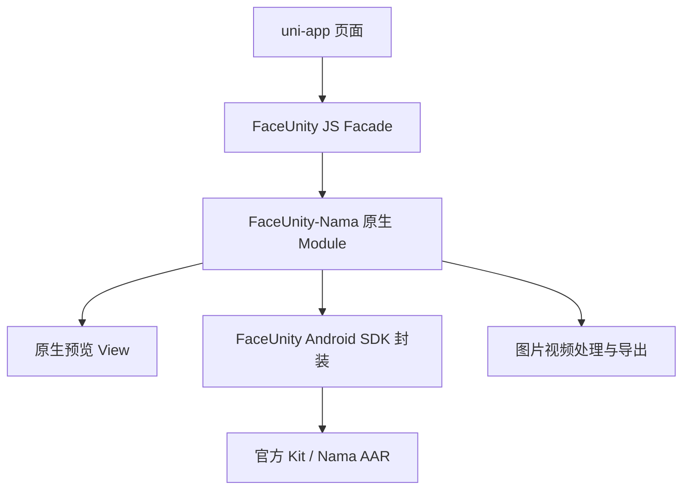

# Android / uni-app 原生能力边界 Spec

## 1. 文档目的

本文定义 uni-app 页面、原生桥接层和 FaceUnity Android SDK 之间的职责边界，并作为后续 Android 接入改造、接口调整和回归测试的依据。

本文针对当前项目采用的 **position 原生叠加方案**。本阶段不引入 `<face-unity-view>` 原生组件，也不要求把美颜页面改成 nvue。

## 2. 最终架构决定



### 2.1 uni-app 页面

负责：

- 首页、相册选择页、预览页和结果页；
- 按钮、滑杆、滤镜列表和业务交互；
- 页面跳转；
- 选择本地图片或视频；
- 测量预览区域位置；
- 展示处理结果、进度和错误提示。

不负责：

- 创建或操作 `GLSurfaceView`、`FUGLSurfaceView`；
- 直接调用 `CameraRenderer`、`PhotoRenderer`、`VideoRenderer`；
- 实现 OpenGL、逐帧处理、编码和音频合成；
- 复制 Demo Activity 或 Demo XML 页面。

### 2.2 JS Facade

由 `src/utils/face-unity.ts` 对外提供，底层实现仍在 `src/utils/nama-app.ts`。它是 uni-app 的稳定入口，负责：

- 获取 `uni.requireNativePlugin('FaceUnity-Nama')`；
- 统一 Promise、超时和错误处理；
- 规范图片/视频路径；
- 将页面坐标传给原生桥；
- 将原生回调转换为页面可用的数据。

页面只应依赖 `src/utils/face-unity.ts`，不应直接引用 `nama-app.ts` 或操作插件对象。

### 2.3 Android 原生 Module

当前由 `NamaModule` 承担。负责：

- 初始化和销毁 SDK 会话；
- 创建、挂载、调整和隐藏原生预览 View；
- 将 uni-app 坐标转换为 Android 物理像素；
- 调用官方 Kit/Nama 渲染接口；
- 调用图片处理、视频逐帧处理和导出能力；
- 回传结果、进度和错误；
- 管理 Activity、Surface、OpenGL 和 SDK 生命周期。

不负责：

- 规定调用方页面长什么样；
- 强制调用方使用 Demo 页面；
- 把相册选择作为 FaceUnity 核心能力；
- 将 `FUGLSurfaceView` 或内部 Renderer 类型作为对外接口。

### 2.4 Android SDK / AAR 封装层

保留官方 AAR 和现有可复用的渲染、处理实现。对 Module 提供内部能力：

- 相机实时渲染；
- 图片预览和图片导出；
- 视频预览和视频导出；
- 美颜参数和滤镜设置；
- 相机拍照和录像；
- 编码、复用音频和输出文件。

图片预览的具体承载关系如下：

- `NamaModule` 创建一个原生 `GLSurfaceView` 承载层 `PhotoRendererGLView`；
- `PhotoRendererGLView` 内部实例化官方 AAR 的 `com.faceunity.core.renderer.PhotoRenderer`；
- `PhotoRenderer` 负责图片读取、纹理创建、`FURenderKit` 渲染和画面绘制；
- uni-app 只通过 `showImagePreview`、`redrawImagePreview` 等桥接方法控制它，不接触 `PhotoRenderer`、`GLSurfaceView` 或源码；
- Android 图片预览和图片导出走官方 Kit；视频预览和视频导出仍保留现有原生兼容链路，不能把视频部分描述为纯官方 Kit。

Demo Activity、页面布局和页面按钮不属于正式 SDK 接口。

## 3. position 预览协议

### 3.1 页面侧流程

```text
uni-app 放置预览占位区域
  ↓
boundingClientRect 获取位置和大小
  ↓
补充 WebView 屏幕偏移
  ↓
调用 showCamera / showImagePreview / showVideoPreview
```

### 3.2 坐标定义

页面传入：

```ts
type NativePreviewRect = {
  x: number
  y: number
  width: number
  height: number
}
```

约定：

- 页面侧使用 uni-app 页面坐标；
- 页面侧不直接处理 Android density；
- Android 桥统一使用 `cssToPhysical(density, value)` 转换；
- `x/y` 以宿主 Activity 的内容区域为目标；
- 状态栏、WebView 偏移、安全区差异由页面测量函数和平台适配处理；
- 原生桥保存最近一次预览区域，用于对焦、录制、媒体层切换和重绘。

### 3.3 对外 JS 接口

当前实现保留原生方法名以兼容已有基座，JS Facade（`src/utils/face-unity.ts`）统一提供以下能力：

```ts
showCameraPreview(rect, extra?)
resizeCameraPreview(rect)
hideCameraPreview()
detachCameraOverlay()

mountImagePreview({ path, ...rect })
mountVideoPreview({ path, ...rect })
destroyImagePreview()
destroyVideoPreview()

captureCameraPhoto()
startCameraVideoRecord()
stopCameraVideoRecord()
```

`showCamera`、`showImagePreview`、`showVideoPreview` 等是桥内部方法；JS Facade 对外使用 `mount*` 命名，不作为调用方理解底层实现的依据。

## 4. 图片和视频边界

### 4.1 选择媒体

选择入口和页面由 uni-app/调用方负责。调用方可以使用 uni-app 选择能力，也可以使用原生系统选择器，但选择器属于调用方媒体工具，不属于 FaceUnity 核心处理接口。

当前项目可以继续通过 JS Facade 的 `chooseMedia` 复用原生系统选择器，但该方法在架构上归类为 App 媒体适配能力。

### 4.2 输入路径

进入原生处理前，必须将输入整理为 SDK 可读取的稳定路径：

```text
content:// 或临时路径
  ↓
resolveLocalMediaPath / normalizeLocalMediaFile
  ↓
App 私有目录中的本地文件
  ↓
processImage / processVideo / 预览
```

不保证临时路径在异步处理期间持续有效。

### 4.3 输出结果

成功返回至少包含：

```json
{
  "path": "/app/cache/nama_result.mp4"
}
```

失败返回统一的错误信息。视频处理必须在 Spec 和测试记录中明确：

- 是否保留原音频；
- 输出格式；
- 处理时长限制；
- 进度回调频率；
- 文件保存位置和生命周期。

## 5. 生命周期和资源规则

```text
页面进入
  → init
  → load AI / beauty bundle
  → show preview

页面隐藏
  → pause / soft hide

返回页面
  → resume
  → 必要时 remount preview

页面销毁
  → destroy preview
  → 释放媒体资源
  → 必要时 invalidate SDK session
```

要求：

- 页面不得通过隐藏 View 的方式直接销毁 Surface；
- SDK 初始化、AI 和 bundle 加载不能被页面重复并发触发；
- 原生桥必须能处理页面快速进入、快速退出和重复挂载；
- 所有异步处理必须在成功、失败和超时路径结束；
- 相机、媒体预览和离线导出不能同时错误地占用同一套 GL 资源。

媒体页跨页面切换必须有全局清理屏障：

- 媒体页 `onUnload` 发起的图片/视频 Renderer 销毁必须串行完成；
- 新媒体页 `onLoad`、相机页 `onShow` 必须等待上一次媒体清理完成；
- 清理未完成或超时，不能假设旧 Surface 已经释放并立即创建新 Renderer；
- 官方 Kit 相机经过 `CameraRenderer.onPause()` 后，恢复时必须重新绑定 RenderKit，并主动请求一帧；
- 官方 `PhotoRenderer` 页面重新显示时必须执行对应的 `onResume()` 和 `requestRender()`。

### 5.1 GLSurfaceView / Renderer 初始化顺序（强制）

官方 Demo 的顺序必须原样保留，不能因为增加一层承载 View 而提前调用 GL 配置接口：

```text
创建 PhotoRendererGLView
  → 将 View 加入父容器
  → 创建 PhotoRenderer
  → PhotoRenderer 内部 setRenderer(this)
  → 再设置 RENDERMODE_WHEN_DIRTY
  → load 图片并 requestRender
```

强制规则：

- `PhotoRendererGLView` 构造函数只能设置 View、Surface 和层级属性；
- 在 `setRenderer(...)` 之前，禁止调用 `setRenderMode(...)`、`requestRender()` 或依赖 GLThread 的接口；
- `PhotoRenderer` 的构造和渲染模式设置必须参考当前 Demo 的 `PhotoRenderer.kt`，不能凭经验重复实现；
- `onSurfaceCreated` 之后才能配置图片 AI 模式和 FaceBeauty；
- `onRenderAfter` 或首帧回调之前，不得认为图片预览已经可用；
- 图片保存必须读取官方 Renderer 的当前输出纹理，不能重新走旧 Nama item 处理一遍。

### 5.2 失败路径边界

图片“预览”与“导出”是两种不同能力，禁止用导出结果图伪装预览：

```text
挂载失败 → 返回明确的挂载错误 → 不调用 processImage 作为预览回退
挂载成功 → PhotoRenderer 持续渲染 → 调参只改官方 Kit 参数并 requestRender
点击保存 → 从当前 PhotoRenderer 输出帧截图并返回文件路径
```

如果原生预览层没有挂载，`processImage` 只能返回错误，不能再次创建旧图片 item 或生成静态图掩盖问题。这样可以保证日志和页面现象对应同一条链路。

## 6. 层级处理约定

当前 Android 预览 View 可能使用 `SurfaceView/GLSurfaceView` 的原生层级能力，因此页面控件不保证能覆盖在预览 View 上方。

本阶段约定：

- 预览区域和页面交互控件尽量分区；
- 需要盖在原生预览上的提示、拍摄控件或对焦控件，可以继续使用原生 Overlay；
- 原生 Overlay 是兼容性实现，不代表 SDK 必须提供 Demo 页面；
- 后续如要全部使用 uni-app UI，应单独评估 TextureView、nvue 或其他同层方案。

## 7. 改造范围

### 本阶段实施

- 新增并遵循本文档；
- 以 `nama-app.ts` 作为 JS Facade；
- 集中预览坐标和媒体路径适配；
- 保留现有 position 原生 View 挂载方式；
- 保留现有官方 Kit 相机和 Nama 媒体处理能力；
- 将原生页面、原生按钮和原生美颜面板标记为可选兼容能力；
- 页面不新增对内部 Java View 或 Demo Activity 的依赖。

### 本阶段不实施

- 不开发 `<face-unity-view>` 原生组件；
- 不要求页面迁移到 nvue；
- 不重写官方 AAR；
- 不复制 Demo 页面；
- 不在 uni-app 中实现 OpenGL、视频逐帧处理或编码。

## 8. 验收标准

### 页面和桥接

- 页面只调用 JS Facade；
- 页面不引用 `GLSurfaceView`、`CameraRenderer` 等类型；
- Android 和 iOS 预览区域位置正确；
- 预览区域调整后不重复创建 SDK 会话；
- 页面返回和重进不出现黑屏或旧 View 残留。

### 媒体

- 图片选择结果可以被原生处理；
- 视频选择结果可以被原生预览和导出；
- `content://` 或临时路径不会直接导致解码失败；
- 成功返回输出路径，失败返回可读错误；
- 视频音频保留情况有实测记录。

### SDK 升级

- 替换官方 AAR 或内部 Renderer 时，uni-app 页面接口不变；
- Demo 页面升级不会要求复制 Activity、布局或 Java View；
- 基座缺少新接口时，JS Facade 能明确提示需要重新制作基座。

### 8.1 真机验证门槛

涉及原生 AAR、Renderer、GLSurfaceView 或桥接方法的修改，必须同时满足以下条件才算完成：

1. `scripts/build-bridge/build-aar.sh` 编译通过；
2. `scripts/rebuild-android-local.sh` 完整重建并安装 APK；
3. 设备上重新选择一张图片，不能只看已有页面或热更新结果；
4. 日志至少出现：

```text
loadBundle officialImage: skip legacy media item
PhotoRenderer mounted
onSurfaceCreated configured kit=true
onRenderAfter texture=<positive number>
```

5. 图片页面截图确认没有先显示 Vue 原图；
6. 调节一个参数后再次出现 `onRenderAfter`，并确认画面仍有官方效果；
7. 点击保存后返回有效图片路径，并确认没有出现 `processImage official capture overlay=false`。

只满足“代码编译通过”或“页面能打开”不能作为原生渲染改造完成的依据。

### 8.2 日志诊断规则

遇到图片异常时，先按日志分层判断，不根据单一页面现象猜测：

| 日志结果 | 结论 | 优先检查位置 |
| --- | --- | --- |
| 没有 `showImagePreview entered` | 桥接方法没有被调用或页面流程未走到挂载 | JS Facade、基座方法注册、页面调用时序 |
| 有 `showImagePreview entered`，没有 `PhotoRenderer mounted` | 原生挂载或 View 构造失败 | `mountImageOverlay`、View 创建、父容器 |
| 有 `PhotoRenderer mounted`，没有 `onSurfaceCreated` | Surface/Renderer 生命周期未建立 | `setRenderer` 顺序、View 是否真正加入窗口 |
| 有 `onSurfaceCreated`，没有 `onRenderAfter` | 官方 Kit 或 GL 渲染没有出帧 | AAR、GL 线程、图片路径、AI 初始化 |
| 有 `onRenderAfter`，调参后无新帧 | 参数写入没有触发 requestRender 或线程不一致 | `setParam`、GL 线程同步、`redrawImagePreview` |
| 返回选图页后再次进入黑屏 | 旧媒体 Renderer 尚未完成销毁，或相机 Kit 未重新绑定 | 跨页面清理屏障、`onResume`、RenderKit bind、`requestRender` |
| 出现 `processImage official capture overlay=false` | 预览层挂载失败后错误进入保存/回退路径 | 先修复挂载，不调整图片算法 |

每次只允许根据日志确认的层级修改对应层，不能用修改另一条链路来“碰运气”。

### 8.3 Demo 对照要求

新增或修改官方 Renderer 承载代码时，提交记录必须注明对应 Demo 文件和调用顺序，至少对照：

- `ShowPhotoActivity.java`：图片页何时配置 AI 和 FaceBeauty；
- `PhotoRenderer.kt`：何时 `setRenderer`、何时设置渲染模式、何时读取图片；
- `BaseFURenderer.kt`：渲染前、渲染后和绘制完成回调的含义。

不得只对照最终截图，不得只复制类名或方法名。

## 9. 当前未验证项

- 所有目标 Android 机型上的 Surface 层级组合；
- Kit 相机在 position 调整、切后台和快速重进场景下的稳定性；
- 全量视频音频保留和不同编码格式兼容性；
- 以第三方调用方页面为宿主时的坐标偏移差异；
- 官方 AAR 升级后的公开 Renderer API 兼容性。
